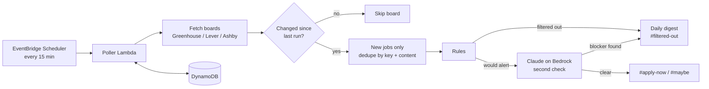

# Job Alert System

Job Alert System watches ~9,300 company job boards every 15 minutes and sends new early-career software engineering roles to Discord, so I can apply within minutes of a posting going live. It runs serverless on AWS for about $5/month.

Each new posting goes through deterministic rules first, then a budgeted second check by Claude on Amazon Bedrock, so only roles worth opening ping my phone.


## Core Features

* **Fast, Broad Coverage**: Scans ~278K postings across ~9,300 Greenhouse, Lever, and Ashby boards every 15 minutes using async fetching, and skips boards whose job list hasn't changed
* **Rules-First Routing**: Free checks for title, level, location, years of experience, clearance, degree, and employment type decide most jobs before any LLM call
* **LLM Second Check**: Claude on Amazon Bedrock reviews only the jobs about to alert, finding blockers the rules missed (buried years, graduation windows, non-CS majors, non-US locations)
* **Hallucination Guard**: An LLM finding counts only if its quote appears word for word in the posting
* **Hard Cost Cap**: Every call's real cost is tracked in DynamoDB; checks stop at a daily dollar limit, with part of the budget kept for #apply-now
* **Discord Alerts**: Cards in #apply-now and #maybe show the location, the reason, technologies I know vs. ones new to me, and the posting's key requirements
* **Discord Bot**: An Apply button records each application, and `/restore <code>` brings back any filtered job from the daily digest
* **Self-Monitoring**: CloudWatch alarms post to #system-health when a run fails or stops running, and failed alerts are retried on the next run instead of being lost


## How It Works



| Channel | What goes there |
| --- | --- |
| **#apply-now** | Early-career title (New Grad, Junior, Engineer I…) with no blockers. Pings my phone. |
| **#maybe** | In-scope role asking 0–2 years, or no years stated. Pings my phone once LLM-checked. |
| **#filtered-out** | Daily 7 AM digest of filtered jobs with the reason and a restore code. |
| **#system-health** | Crash reports and CloudWatch alarms. |


## Design Decisions

* **Rules before the LLM.** Most decisions are explicit facts in the text ("5+ years", "active TS/SCI"), and regex settles them for free. The LLM only handles what rules can't judge, which made a $5/month budget workable.
* **Quote verification.** The model must return an exact quote for every blocker. Quotes not found in the posting are discarded, so a made-up reason can't filter out a real job.
* **Nothing is lost on failure.** Each board has a 60-second limit, and the run stops starting new boards before Lambda's timeout. Jobs that couldn't be alerted are un-marked as seen and retried on the next run.
* **Change detection.** A hash of each board's job IDs is stored, so boards with no new postings are skipped without further work.
* **Public APIs only.** Jobs come from Greenhouse, Lever, and Ashby's documented public job board APIs.


## Tech Stack

* Python 3.12 (asyncio, httpx, pydantic)
* AWS Lambda (ARM64)
* Amazon DynamoDB
* Amazon EventBridge Scheduler
* Amazon Bedrock (Claude Haiku 4.5)
* AWS CDK (infrastructure as code)
* AWS Systems Manager Parameter Store (encrypted secrets)
* Amazon CloudWatch + SNS (alarms)
* Discord webhooks and interactions API (PyNaCl for signature verification)
* pytest and moto for tests


## Cost

About $5/month total:

| Service | Monthly |
| --- | --- |
| Bedrock (LLM checks, capped at $0.16/day) | ≤ $5 |
| Lambda, DynamoDB, CloudWatch, Scheduler, SSM | ~$0 (within AWS's always-free allowances) |


## Getting Started Locally

### Prerequisites
- AWS account with Bedrock access to Claude Haiku 4.5, and the AWS CLI signed in
- Node.js (for the AWS CDK CLI) and Docker (CDK uses it to bundle the Lambda code)
- A Discord server with a bot application and four channels: #apply-now, #maybe, #filtered-out, #system-health

### Setup
1. Clone the repository

2. Create a virtual environment and install dependencies:

```
python -m venv .venv
source .venv/bin/activate
pip install -r requirements-dev.txt -r requirements-infra.txt
npm install -g aws-cdk
```

3. Create `.env` in the project folder:

```
AWS_REGION=your_region
BEDROCK_MODEL_ID=your_claude_haiku_4_5_inference_profile_id
ALERT_EMAIL=your_email
DISCORD_APP_ID=...
DISCORD_GUILD_ID=...
DISCORD_PUBLIC_KEY=...
DISCORD_BOT_TOKEN=...
DISCORD_ROLE_ID=...
DISCORD_WEBHOOK_APPLY_NOW=...
DISCORD_WEBHOOK_MAYBE=...
DISCORD_WEBHOOK_FILTERED_OUT=...
DISCORD_WEBHOOK_SYSTEM_HEALTH=...
```

`python create_webhooks.py` creates the four webhooks with the bot and prints their `.env` lines.

4. Run the tests:

```
python -m pytest
```

5. Deploy to AWS, store secrets, load companies, and register the slash command:

```
cdk bootstrap
cdk deploy
python upload_secrets.py
python import_companies.py
python register_commands.py
```

6. In the Discord Developer Portal, set the bot's **Interactions Endpoint URL** to the `DiscordInteractionsUrl` printed by `cdk deploy`.

### Configuration
- **`criteria.yaml`**: title keywords, locations, years limit, graduation date, technologies, and the skills shown as "You know"
- **`companies.yaml`**: favorite companies, checked first in every run

### Useful Scripts
- `python run_once.py --limit 25`: one pipeline run from your machine
- `python send_digest.py`: send the daily digest now
- `python restore.py <code>`: same as `/restore` in Discord


## Future Features

* Workday and large-company career sites, where their terms allow automated access
* A weekly summary of applications and response rates
* Tuning #maybe from which alerts I actually apply to


## Data Sources
Company directory: [LastRound AI ATS Company Directory](https://lastroundai.com/blog/salary-transparency-study-2026), licensed CC BY 4.0.

Additional boards: [datakit457/ats-company-slugs](https://github.com/datakit457/ats-company-slugs) (CC0).